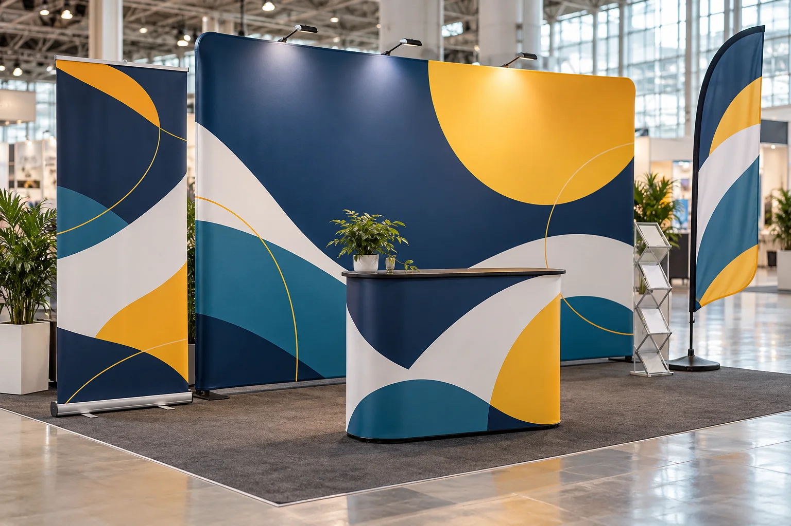

# Messewand kaufen in Essen: Messewände, Roll-ups und Messeausstattung gestalten lassen

**Sie planen einen Messestand und suchen eine individuell gestaltete Messewand, einen aufmerksamkeitsstarken Messebanner oder mobile Displays?** Mediencenter Essen unterstützt Unternehmen bei der Gestaltung und Produktion passender Messewerbung – vom ersten Layout bis zu Druck und Lieferung, abgestimmt auf Produkt und Projekt.

➡️ **[Messewand, Messebedarf und Druckleistungen bei Mediencenter Essen ansehen](https://mediencenteressen.com/unsere-dienstleistungen/messedruck-messebedarf/)**

*Ein überzeugender Messeauftritt verbindet eine klare Botschaft mit einer passenden Messewand und flexiblen Werbedisplays.*

## Messeausstattung in Essen: Gestaltung und Druck passend zum Messestand

Auf einer Messe entscheiden oft wenige Sekunden darüber, ob Besucher einen Stand wahrnehmen und stehen bleiben. Eine gute Messewand macht Ihr Unternehmen auf den ersten Blick erkennbar. Roll-ups vermitteln einzelne Leistungen oder Produkte, während Messebanner und Beachflags zusätzliche Fläche und Orientierung schaffen.

Mediencenter Essen begleitet Sie bei der Gestaltung und Umsetzung dieser Werbemittel. Wir stimmen Motiv, Format, Material und Einsatzort aufeinander ab, damit die Messewand, das Roll-up und weitere Druckprodukte wie ein gemeinsamer Markenauftritt wirken. Großformate wie Banner, Planen und Beachflags werden in Essen gedruckt. Je nach Produkt und Projekt können auch Druckabwicklung, Konfektionierung, Displaysystem und Versand angefragt werden.

## Welche Messeleistungen bietet Mediencenter Essen?

| Leistung | Geeignet für | Was wir übernehmen können |
| --- | --- | --- |
| **Messewand und Rückwand** | Markenfläche, Hintergrund und Präsentationswand am Messestand | Gestaltung der großflächigen Werbefläche und Abstimmung des Druckmotivs auf Format, Betrachtungsabstand und Display-System. Bedruckte Textilbanner eignen sich insbesondere für Präsentations- und Innenbereiche. |
| **Messebanner und Planen** | Rückwand, Promotionfläche, Event und großformatige Messekommunikation | Individuelles Design, Beratung zu geeigneten Materialien, druckgerechte Datenaufbereitung sowie Großformatdruck und Konfektionierung auf Wunsch. |
| **Roll-up-Banner** | Ergänzung am Messestand, Empfang, Kongress oder Präsentationsbereich | Individuelles Roll-up-Design; auf Wunsch einschließlich Druck, passendem Roll-up-System, Konfektionierung und Versand. Mögliche Formate reichen von 85 × 200 cm bis zu großformatigen Varianten bis 200 × 300 cm. |
| **Beachflags** | Sichtbarkeit am Eingang, im Außenbereich und bei Promotions | Gestaltung und Druck auf Fahnenstoff; je nach Bedarf in unterschiedlichen Formen, Größen und mit passender Befestigung. Für Messen sind zum Beispiel Kreuzfuß und Wassertank eine mögliche Lösung. |
| **Messeflyer und ergänzende Printprodukte** | Produktinformationen, Gesprächsunterlagen und Kontaktweitergabe | Gestaltung von Messe- und Eventflyern sowie ergänzenden Werbemitteln im einheitlichen Erscheinungsbild. |

Der konkrete Umfang hängt vom gewünschten System, den vorhandenen Druckdaten und dem Einsatzzweck ab. Wenn Sie bereits eine Messewand oder ein Display besitzen, können Sie Format- und Systemangaben in Ihre Anfrage aufnehmen. So lässt sich vorab klären, welche Druckfläche, Materialausführung und Datenaufbereitung gebraucht werden.

## Messewand bedrucken lassen: das Motiv muss aus der Entfernung funktionieren

Eine Messewand ist keine Broschüre im Großformat. Besucher bewegen sich, sehen die Fläche oft aus mehreren Metern Entfernung und haben nur wenig Zeit. Darum braucht das Design eine klare visuelle Reihenfolge:

1. **Unternehmen oder Marke:** Logo und Farben machen den Absender schnell erkennbar.
2. **Kernbotschaft:** Eine kurze, verständliche Aussage zeigt, was Sie anbieten.
3. **Nutzen:** Wenige gut lesbare Argumente helfen Besuchern, Ihr Angebot einzuordnen.
4. **Bild oder Produkt:** Ein aussagekräftiges Motiv bringt das Thema auf den Punkt.
5. **Nächster Schritt:** Website, QR-Code oder Kontaktmöglichkeit führen das Gespräch weiter.

Wir gestalten Messewände und Messebanner passend zu Ihrem Corporate Design. Wenn noch kein fertiges Konzept vorliegt, können wir aus Logo, Unternehmensinformationen, Bildern und Projektziel einen Gestaltungsansatz entwickeln. Vor der Produktion prüfen wir das Format und bereiten die freigegebenen Daten druckgerecht vor.

### Messewand nach Maß oder vorhandenes System?

Für die Gestaltung und Produktion sind die Maße der sichtbaren Druckfläche entscheidend. Senden Sie uns nach Möglichkeit die genaue Breite und Höhe, das Display-Modell oder die Vorgaben des Systemherstellers. Bei bestehenden Systemen sollten außerdem Angaben zu Beschnitt, Randbereichen, Befestigung und Material berücksichtigt werden. So kann das Motiv auf die verfügbare Fläche abgestimmt werden.

Wenn Sie eine komplette Messewand inklusive Gestell oder ein bestimmtes Display-System benötigen, nennen Sie den gewünschten Umfang direkt bei der Anfrage. Wir klären dann, welche Ausführung für Ihr Vorhaben verfügbar ist und ob sich vorhandene Systeme weiterverwenden lassen.

## Messebanner und Textilbanner für Messestand und Rückwand

Je nach Einsatzort kommen unterschiedliche Materialien infrage. Mediencenter Essen gestaltet [Banner und Planen für Messen, Events und Präsentationsflächen](https://mediencenteressen.com/unsere-dienstleistungen/banner-planen-gestalten-lassen/) und berät dazu, welche Ausführung zum Motiv und Einsatz passt.

- **Textilbanner:** textile, hochwertige Anmutung für Messestände, Showrooms und Innenbereiche. Textilbanner können für Displaysysteme eingesetzt werden.
- **PVC-Plane:** geschlossene, vielseitige Werbefläche für Banner und Planen.
- **Mesh-Plane:** netzartige, luftdurchlässige Ausführung, wenn bei großen Flächen die Windbelastung eine Rolle spielt.
- **Blockout-Material:** blickdichte Lösung, wenn ein Untergrund nicht durchscheinen soll oder eine beidseitige Fläche geplant ist.

Material, Druckverfahren und Konfektionierung werden projektbezogen abgestimmt. Teilen Sie deshalb mit, ob die Fläche in einer Halle, am Messestand, im Eingangsbereich oder zeitweise im Außenbereich eingesetzt wird.

## Roll-up gestalten und drucken lassen

Ein Roll-up ergänzt eine Messewand um eine zusätzliche, mobile Informationsfläche. Es kann als kompakter Produktaufsteller, zur Vorstellung einer Dienstleistung oder als Wegweiser am Messestand dienen. Für eine gute Wirkung sollte es aus der Entfernung lesbar bleiben und nur die Informationen zeigen, die Besucher wirklich benötigen.

Mediencenter Essen gestaltet [Roll-up-Banner individuell](https://mediencenteressen.com/unsere-dienstleistungen/rollup-banner-gestalten-lassen/) und auf Wunsch als Komplettpaket mit Druck, Roll-up-System und Lieferung. Zu den angebotenen Größen zählen beispielsweise 85 × 200 cm, 100 × 200 cm, 120 × 200 cm, 150 × 200 cm sowie größere Formate bis 200 × 300 cm. Welche Größe passt, hängt von Platz, Betrachtungsabstand, Motiv und Standfläche ab. Klassische Roll-up-Systeme sind vor allem für Innenräume gedacht; für windige Außenbereiche sind Banner, Planen oder Beachflags meist geeigneter.

Auch ein vorhandenes Roll-up-Design kann überarbeitet, aktualisiert oder an ein neues Corporate Design angepasst werden. Wenn Sie schon eine Druckdatei haben, können Sie sie zur Prüfung der Produktionsvorgaben einreichen.

## Beachflags und mobile Messewerbung

Beachflags ergänzen den Messestand um eine hohe, weithin sichtbare Werbefläche. Sie eignen sich für Messe-Eingänge, Promotion-Aktionen, Veranstaltungen und – abhängig von Material und Befestigung – Außenbereiche.

Für unterschiedliche Auftritte kommen etwa Tropfen-, Segel-, gerade oder rechteckige Formen sowie kompakte Tisch-Beachflags infrage. Die Befestigung richtet sich nach Standort und Untergrund: Für Hallen und Events ist ein Kreuzfuß mit Wassertank eine Option; für Rasen oder Sand kann ein Erdspieß passen. Mediencenter Essen gestaltet die Fahne passend zur Marke und übernimmt den Druck. Mehr zu [Beachflags und weiteren Print-Design-Leistungen](https://mediencenteressen.com/d/print-design/). Die geeignete Ausführung wird anhand Ihres Einsatzorts ausgewählt.

## Messeflyer und passende Drucksachen aus einem Guss

Ein gutes Messegespräch lässt sich mit gedruckten Informationen fortsetzen. Messe- und Eventflyer, Folder oder Visitenkarten können die Botschaft der Messewand aufnehmen und Interessenten konkrete Produkt- und Kontaktdaten mitgeben. Durch abgestimmte Farben, Schriften und Bildsprache entsteht ein wiedererkennbarer Auftritt über Stand, Display und Handout hinweg.

Mediencenter Essen gestaltet Flyer und Broschüren für unterschiedliche Formate und Einsatzzwecke. Weitere Werbemittel können je nach Projekt ergänzt werden. Wenn Sie mehrere Produkte benötigen, nennen Sie diese gemeinsam: So lassen sich Gestaltung und Produktionsablauf aufeinander abstimmen.

## Von der Anfrage zur fertigen Messeausstattung

### 1. Briefing und Einsatz klären

Wo wird die Messewand eingesetzt? Welche Standfläche, Zielgruppe und Botschaft sind wichtig? Teilen Sie uns außerdem mit, ob es bereits ein Display-System, ein Corporate Design oder fertige Druckdaten gibt.

### 2. Format und Material abstimmen

Wir berücksichtigen Maße, Betrachtungsabstand, Innen- oder Außeneinsatz, Befestigung und gewünschte Nutzungsdauer. Bei vorhandenen Systemen helfen Herstellerangaben, damit Druckfläche und Daten korrekt vorbereitet werden.

### 3. Gestaltung passend zur Marke entwickeln

Das Layout orientiert sich an Ihrem Unternehmen und dem Zweck des Messeauftritts. Auf Wunsch unterstützen wir bei der Struktur der Inhalte, der Bildauswahl, der Integration eines QR-Codes und der Abstimmung mit Roll-ups oder Messeflyern.

### 4. Entwurf prüfen und freigeben

Sie prüfen die Gestaltung und geben die finale Version für die Produktion frei. So können Änderungen vor dem Druck abgestimmt werden.

### 5. Druck und Lieferung abstimmen

Großformate wie Banner, Planen und Beachflags drucken wir in Essen. Je nach Produkt übernehmen wir außerdem die Druckabwicklung, Konfektionierung sowie Verpackung und Versand. Den genauen Lieferumfang stimmen wir im Angebot mit Ihnen ab.

## Warum Mediencenter Essen für Messewände und Messebedarf?

- **Gestaltung und Druck abgestimmt:** Das Motiv wird für das konkrete Format und die spätere Betrachtung geplant.
- **Individuelles Design:** Ihre Messewand oder Ihr Roll-up entsteht passend zu Ihrer Marke statt aus einer beliebigen Standardvorlage.
- **Großformatdruck in Essen:** Banner, Planen und Beachflags werden im eigenen Haus produziert.
- **Unterstützung vom Entwurf bis zur Umsetzung:** Druckdaten, Produktion und Lieferung können je nach Produkt gemeinsam geplant werden.
- **Ergänzende Werbemittel:** Messebanner, Roll-ups, Beachflags und Flyer lassen sich visuell aufeinander abstimmen.

Ob Sie eine Messewand bedrucken lassen, ein Roll-up für eine Messe gestalten möchten oder noch die passende Messeausstattung für Ihren Stand planen: Eine gute Anfrage beginnt mit den Abmessungen, dem Einsatzort und der gewünschten Botschaft. Damit kann Mediencenter Essen schneller einschätzen, welche Lösung für Ihr Projekt passt.

## Häufige Fragen zu Messewand, Messebanner und Messebedarf

### Kann Mediencenter Essen eine Messewand gestalten und bedrucken?

Mediencenter Essen gestaltet großformatige Werbeflächen für Messestand, Messewand und Rückwand. Bedruckte Textilbanner sind für Präsentationsflächen und Displaysysteme geeignet. Teilen Sie uns Maße und Systemvorgaben mit, damit wir Druckfläche und Umsetzung für Ihr konkretes Projekt abstimmen können.

### Kann ich eine Messewand mit meinem eigenen Design bestellen?

Ja, die Gestaltung kann auf Ihr Unternehmen, Ihr Corporate Design und den Einsatzzweck abgestimmt werden. Wenn Sie bereits ein fertiges Motiv haben, sollten Sie die Vorgaben des Display- oder Systemherstellers für Format, Beschnitt und Druckdaten mitschicken.

### Gibt es auch Roll-ups mit Druck und System?

Roll-ups können individuell gestaltet und auf Wunsch inklusive Druck, passendem System und Versand angefragt werden. Möglich sind verschiedene Breiten und Höhen von kompakten Standardformaten bis zu größeren Präsentationsflächen.

### Welche Messewerbung eignet sich für den Außenbereich?

Das hängt von Standort, Windbelastung und Befestigung ab. Banner aus Mesh lassen Luft besser durch, während Beachflags mit einer für den Untergrund geeigneten Befestigung mobil eingesetzt werden können. Klassische Roll-ups sind überwiegend für Innenbereiche gedacht.

### Druckt Mediencenter Essen Banner selbst?

Großformate wie Banner, Planen und Beachflags werden auf dem eigenen Großformatdrucker in Essen produziert. Welche Druck- und Konfektionierungsoptionen für Ihr Format verfügbar sind, klären wir projektbezogen.

### Was kostet eine Messewand oder ein Roll-up?

Der Preis hängt unter anderem von Format, Material, Gestaltungsaufwand, vorhandenen Daten und dem gewünschten Lieferumfang ab. Für ein konkretes Angebot helfen die Maße, die Art des Systems, der Einsatzort und die gewünschten Produkte.

### Wann sollte ich eine Messewand anfragen?

Melden Sie sich möglichst früh, damit Briefing, Gestaltung, Korrekturen, Freigabe, Druck und Lieferung vor dem Messetermin eingeplant werden können. Wenn der Termin bereits feststeht, teilen Sie ihn gleich in Ihrer Anfrage mit.

---

## Messewand gestalten und Messebedarf bei Mediencenter Essen anfragen

Sie möchten eine **Messewand in Essen gestalten und bedrucken lassen**, benötigen ein **Roll-up für Ihren Messestand** oder suchen abgestimmte **Messeausstattung mit Banner, Beachflag und Flyer**? Mediencenter Essen unterstützt Sie bei der Planung, Gestaltung und Umsetzung – passend zu Ihrem Format, Ihrer Marke und Ihrem Messetermin.

➡️ **[Messewand, Messebedarf und Druckleistungen bei Mediencenter Essen anfragen](https://mediencenteressen.com/unsere-dienstleistungen/messedruck-messebedarf/)**

---

### Weiterführende Leistungen von Mediencenter Essen

- [Messedruck und Messebedarf](https://mediencenteressen.com/unsere-dienstleistungen/messedruck-messebedarf/)
- [Roll-up-Banner gestalten lassen](https://mediencenteressen.com/unsere-dienstleistungen/rollup-banner-gestalten-lassen/)
- [Banner und Planen gestalten lassen](https://mediencenteressen.com/unsere-dienstleistungen/banner-planen-gestalten-lassen/)
- [Print-Design, Flyer und weitere Werbemittel](https://mediencenteressen.com/d/print-design/)

*Bild oben ist eine eigens generierte illustrative Darstellung und kein Foto eines konkreten Kundenprojekts. Leistungsumfang, Systemverfügbarkeit, Material, Preis und Lieferzeit werden projektbezogen bestätigt.*
